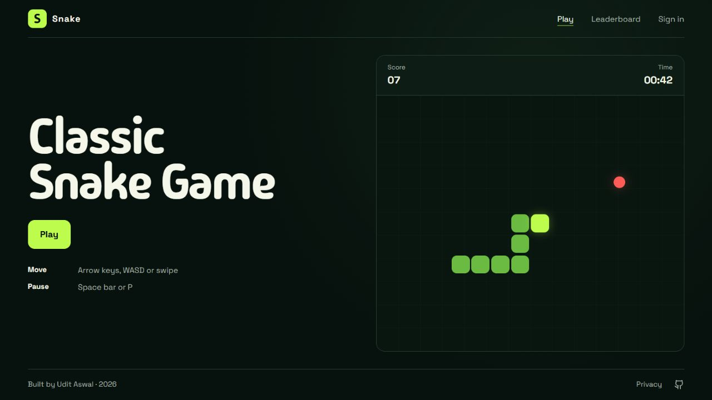
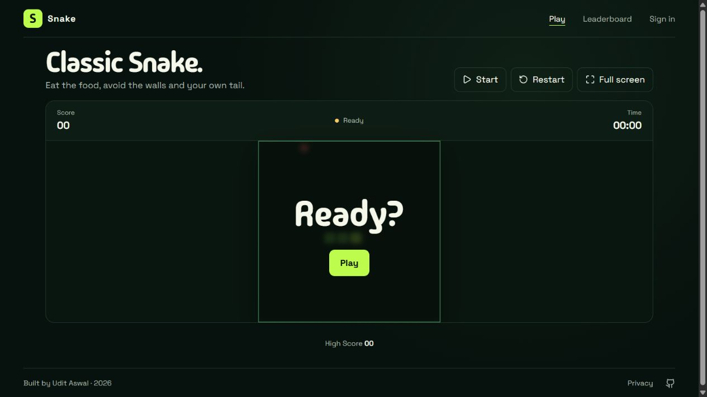

# Snake

A browser Snake game with guest play, keyboard and touch controls, and an optional public leaderboard. Accounts are only needed to publish scores.

**Live site:** [snake-game-two-flame.vercel.app](https://snake-game-two-flame.vercel.app/)



<details>
<summary>See the game screen</summary>



</details>

## What is here

- React, TypeScript, Vite, and Tailwind CSS for the interface; the game engine is separate from React in `src/game/`.
- Native Vercel Node functions in `api/` for accounts, run challenges, and the leaderboard. There is no Express server.
- Neon Postgres via `@neondatabase/serverless`. Only server code reads `DATABASE_URL`.
- Guest play without a database account; signed-in players can use Google or a username and password to save a public personal best.
- Full-screen play, keyboard and swipe controls, a local personal best, a privacy notice at `/privacy`, and terms at `/terms`.

Score submissions are checked against a single-use, short-lived challenge and server-side gameplay rules. This raises the cost of tampering, but a browser game cannot provide a perfect anti-cheat guarantee against a determined client.

## Run locally

Use Node.js 24 and pnpm 10.34.7 (pinned in `package.json`). From the project root:

```bash
corepack enable
pnpm install
pnpm dev:client
```

`dev:client` runs the frontend only. Guest gameplay works; accounts and the public leaderboard need the API and database.

For the complete app:

1. Create `.env.local` from `.env.example`. Set a pooled Neon `DATABASE_URL`, optional direct `DATABASE_URL_UNPOOLED`, `APP_ORIGIN=http://localhost:3001`, `VITE_SITE_ORIGIN=http://localhost:3001`, and a unique `RATE_LIMIT_SECRET` of at least 32 characters. To enable Google sign-in, also set `GOOGLE_CLIENT_ID`, `GOOGLE_CLIENT_SECRET`, and a separate `OAUTH_STATE_SECRET` of at least 32 characters. `VITE_SITE_ORIGIN` is public metadata; never use a `VITE_` prefix for secrets. Neon CLI users can use `neon env pull` for database URLs.
2. Run `pnpm db:migrate` once against the intended Neon branch.
3. Run `pnpm exec vercel login` if the CLI is not already authenticated, then `pnpm dev`.
4. Open the `Service started at ...` URL. `vercel dev` serves both Vite and the native API functions. Login to the CLI does **not** deploy the app.

The frontend can also be run alone without Vercel credentials. For full-stack local development, the repository's launcher uses the local Vercel CLI and avoids the Windows update-check worker timeout. Keep `APP_ORIGIN` and `VITE_SITE_ORIGIN` equal to the browser origin; use `PORT` to override the port if needed.

### Google sign-in setup

Create a Google OAuth client with the **Web application** type. Register these exact callback URLs for the environments you use:

- `http://localhost:3001/api/auth/google/callback`
- `https://snake-game-two-flame.vercel.app/api/auth/google/callback`

Set the client ID and client secret only in `.env.local` and Vercel environment variables; never commit Google’s downloaded credential JSON. The app requests only the `openid` scope, stores no Google access or refresh tokens, and assigns a random public game username. Each preview origin needs its own exact registered callback URL and matching `APP_ORIGIN`; otherwise leave Google sign-in disabled for that preview.

## Verify

```bash
pnpm lint
pnpm test
pnpm build
pnpm test:local
```

Run `test:local` while `pnpm dev` is serving the full app. It registers a temporary account, confirms its session, saves a deterministic seeded run, checks the leaderboard and replay rejection, then deletes the account. It does not print credentials. The database integration test is opt-in because it writes temporary rows:

```powershell
$env:NEON_E2E='1'; pnpm exec vitest run server/neon.integration.test.ts
```

On macOS/Linux, prefix the command with `NEON_E2E=1` instead. To check Vercel's deployable output without deploying, run `pnpm exec vercel build --prod --yes` after linking the project. The repository also runs these checks in CI, runs CodeQL, scans full Git history with Gitleaks, and schedules Dependabot updates.

To block secrets before local commits, install [pre-commit](https://pre-commit.com/) and run `pre-commit install`. The checked-in hook pins Gitleaks. The CI scan still runs when a contributor has not installed the local hook.

## Deploy to Vercel

Import the repository as a Vite project, use pnpm, and deploy the branch you intend to publish. The production deployment needs `DATABASE_URL` and `RATE_LIMIT_SECRET` set as **Production** environment variables in Vercel. Google sign-in additionally needs `GOOGLE_CLIENT_ID`, `GOOGLE_CLIENT_SECRET`, and `OAUTH_STATE_SECRET`; if they are absent, username/password accounts continue to work and the Google option stays hidden. Apply `pnpm db:migrate` to that database before publishing. `APP_ORIGIN` is optional on Vercel: the function derives an origin from Vercel's deployment URL; for a custom domain, set `APP_ORIGIN` to its exact `https://` origin. Set public `VITE_SITE_ORIGIN` to the same canonical origin so metadata and sitemap URLs agree. Do not put secrets in Git or the browser bundle.

The canonical production origin is `https://snake-game-two-flame.vercel.app`. Use that value for `APP_ORIGIN` and `VITE_SITE_ORIGIN` in the Production environment when explicit values are configured.

Preview and Production environments are separate. A Preview deployment needs its own database URL and rate-limit secret to test accounts and scores; without them, the frontend still builds but those API routes cannot work. Prefer a separate Neon branch for Preview rather than sharing production data. Deploying the `dev` branch normally creates a Preview deployment, not a Production deployment.

## Security and privacy

New passwords must be 15 to 128 characters and are Argon2id-hashed. Existing shorter passwords can still be used to sign in, change the password, or delete the account. Google sign-in uses authorization code flow with PKCE, signed short-lived state, a one-time nonce, and server-side ID-token verification. Session tokens are stored as hashes in Postgres and sent to browsers in HttpOnly, SameSite cookies. State-changing API requests check their origin; account and score routes use validation and rate limits. SQL uses parameterized queries. The privacy notice gives a plain-language summary of account and score data, essential storage, service providers, deletion, and contact details. No email address is stored, so forgotten passwords cannot be reset by email.

`.env.local`, Vercel metadata, build outputs, caches, and local issue notes are ignored by Git and Docker. The local smoke test requires a disposable test account; it deletes it after a successful run.
